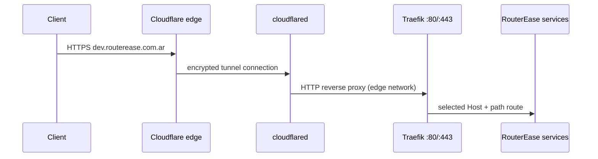

# Cloudflare Tunnel (development)

The public hostname is `dev.routerease.com.ar`. Cloudflare terminates public TLS
and sends traffic through an outbound `cloudflared` connector to Traefik.



1. Create a remotely-managed tunnel in Cloudflare Zero Trust.
2. Add the public hostname `dev.routerease.com.ar`, with service
   `http://localhost:80`. The connector shares Traefik's network namespace,
   so this origin resolves to Traefik's port 80.
3. Put its connector token in the ignored `.env` as `CLOUDFLARE_TUNNEL_TOKEN`.
4. Enable Cloudflare Access before sharing management or CRUD routes.

```sh
cp .env.example .env
# Set all passwords and CLOUDFLARE_TUNNEL_TOKEN in .env
docker compose --profile cloudflare up -d --build
docker compose ps
docker compose logs --tail=100 cloudflared reverse_proxie
curl -fsS -H 'Host: dev.routerease.com.ar' 'http://127.0.0.1/routerease/mac-address/?mac=00:00:5e:00:53:01'
```

Traefik listens on host ports 80 and 443. The tunnel uses Traefik's internal
HTTP listener; public HTTPS is terminated by Cloudflare. Therefore no ACME HTTP
challenge or public certificate on the development host is required. The
`cloudflare` profile lets the rest of the stack start without a tunnel token.

## Troubleshooting `530 / 1033`

If `cloudflared` reports registered tunnel connections but
`https://dev.routerease.com.ar` returns Cloudflare error `1033`, the DNS record
for that hostname is attached to a different tunnel. In Zero Trust, open the
same tunnel used by this connector, remove the stale public hostname entry and
create it again for `dev.routerease.com.ar` with origin `http://localhost:80`.
Do not point the hostname at a LAN address or publish Docker ports directly.
