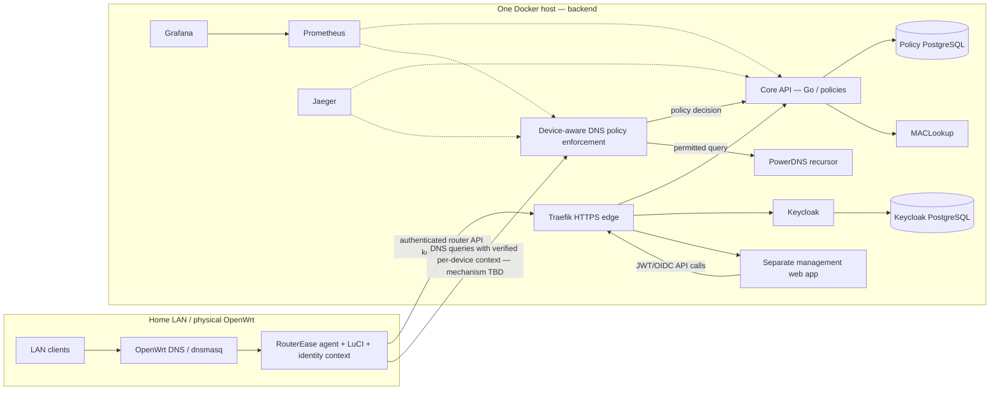

# RouterEase architecture — MVP target and current implementation

**Status**: target design proposed from owner decisions (October 2026); existing status verified by reading `dev-api` code at commit `e3b878358806955da02e45c1ff214d0134ff1ec6` (March 2026). Not a claim that the target is implemented.

## Product topology

**Important**: the line from OpenWrt to the policy DNS service is a design requirement; its protocol/identity mechanics still need an ADR. The production DNS entry point must be deliberately defined. A reverse proxy for HTTP APIs cannot be assumed to proxy DNS UDP/TCP 53. Proxying an entire household via a single upstream connection without client identity makes per-device rules impossible.

## Confirmed boundaries
- **Physical OpenWrt**: local LAN operations, safe configuration, device inventory, small `procd` supervised agent, LuCI subset, authoritative source of leases/neighbor context.
- **Backend host (Docker)**: all policy/auth/business and support services; Keycloak, PostgreSQL, PowerDNS, Traefik, MACLookup, core API, web app, observability. Separate internal/edge exposure. No Kubernetes and no second backend host for MVP.
- **Two web surfaces**: LuCI embedded on router; separate backend-hosted management UI for users, group assignment, domain allow/deny, schedules, status and operational visualizations.
- **Two authorization domains**: human operators authenticate via Keycloak OIDC/JWT; routers authenticate via revocable, scoped API key. Identity of a client device requires additional verified context, never simply the router API key.

## Current `dev-api` Docker inventory (observed, not assumed healthy)
| Component | Source | Role | Important gap |
|---|---|---|---|
| `reverse_proxie` | `API/ReverseProxie/` | Traefik edge, HTTP routes, TLS | `api.insecure: true`, Docker socket, permissive CORS, dashboard published, DNS entry points need validation |
| `whoami` | same | Traefik test service | Dev-only; remove from production profile |
| `go-proxie` | `API/GO-Proxie/` | HTTP CRUD and DoH forwarding | JWT enforcement/blocklist code commented; unprotected CRUD, hardcoded DB DSN |
| `dns` | `API/DNS/` | PowerDNS Recursor | `ALLOW_FROM=0.0.0.0/0`; upstream 8.8.8.8/1.1.1.1; container DNS not yet per-device policy engine |
| `mac-lookup` | `API/MACLookUp/` | OUI lookup | Enrichment is not trusted device identification; OUI DB build runtime considerations |
| `authentication` | `API/Authentication/` | Keycloak IAM | Development startup/hardcoded admin values/exposed backend port |
| `auth_db` | `API/Authentication/` | Keycloak PostgreSQL | Tracked data directory and hardcoded password |
| `dns_db` | `API/GO-Proxie/` | Policy PostgreSQL | Tracked data directory and hardcoded password |
| `prometheus` | `API/Observability/Prometheus/` | Metrics | Separate compose, mismatched scrape service names, no verified production integration |
| `jaeger` | `API/Observability/Jaeger/` | Distributed traces | Separate compose, broad host port exposure |
| `grafana` + `influxdb` | `Package/monitoring/` | Legacy OpenWrt lab metrics | Not chosen backend canonical stack; don't mistakenly treat as production |
| OpenWrt emulator | `Package/` | Lab firmware under Docker | Not an installable physical router package; script manipulates real host networking |

## Actual DNS paths today
`go-proxie` exposes `POST /dns-query`, validates `Content-Type: application/dns-message`, unpacks wire-format DNS and forwards to `dns:53` via the Go DNS client. The JWT claim parsing and blocklist policy decision blocks are commented out in `services/dns-service.go`; consequently per-device filtering is not actually applied by that Go handler. `PowerDNS Recursor` forwards to configured upstreams. The separate experimental `API/DNS/main.go` is not a Compose service; references dnsdist while dnsdist is not present in the aggregator. Do not call this implemented parental control.

## Target request and policy flows
1. Operator signs in to Keycloak with OIDC Authorization Code + PKCE; frontend receives short-lived access token.
2. Frontend calls versioned Go API via Traefik; Go verifies JWT and roles. Admin creates/updates `Policy`, `PolicyRule`, `Assignment`, `Schedule`, `Device`, `Group`, and `Exception`. Database transaction and audit event follow.
3. Router is enrolled using a one-time bootstrap flow and receives a unique scoped API key. Subsequent requests identify the router, not any individual LAN host. Renewal/rotation/revocation supported.
4. On a DNS query, policy enforcement determines origin device using **verified router-scoped network identity** and current lease/neighborhood mapping (design pending); evaluates allowlist precedence, exact/subdomain matching, active schedules and fallback; blocked query produces explicitly specified DNS response, permitted query reaches PowerDNS.
5. Metrics, trace spans and bounded privacy-preserving logs report service health and decisions; no raw DNS payload or secrets by default.

## Proposed Compose topology (to implement, not yet in source)
- `edge`: Traefik, management-web, Keycloak ingress, management API ingress.
- `services`: Core API, DNS policy engine, PowerDNS, MACLookup; internal network not accessible from public network by default.
- `data`: policy Postgres and Keycloak Postgres with named volumes and healthchecks.
- `observability`: Prometheus, Grafana, Jaeger with private-only access and persistent configuration/data as appropriate.
- Optional `lab` profile hosts development OpenWrt emulator **only**, never implied on production.
- Use a canonical `compose.yaml` plus explicit dev overrides/profiles after migration from existing `extends` fragments. Avoid unreviewed overlay/network changes that break current lab.

## DNS-specific architecture questions requiring ADR
- Where is the authoritative device-policy evaluator? On-router dnsmasq with per-device match, on-router tiny local forwarder, or backend resolver supporting secure client-context metadata?
- How are device and router identities authenticated across DNS protocol boundaries, especially when many clients share one NAT IP?
- Whether backend resides on same LAN or routed WAN and implications for 53/DoH endpoints, latency, TLS and abuse protection.
- What happens when backend is unreachable: fail-open, cached last-known-good policies, or fail-closed? How do we prevent total home DNS loss?
- What is the enforceable limit against direct external DoH/DoT or hard-coded DNS on client devices? Document limitations; no claim of universal coverage.

## References for tracing
TIF-4 `2.1.19 Arquitectura General de RouterEase`, figures 3–5 (source document pages ~55–59); TIF results `4.1–4.6` (pages ~86–89). This file distinguishes thesis intent, observable code, and target decisions.
